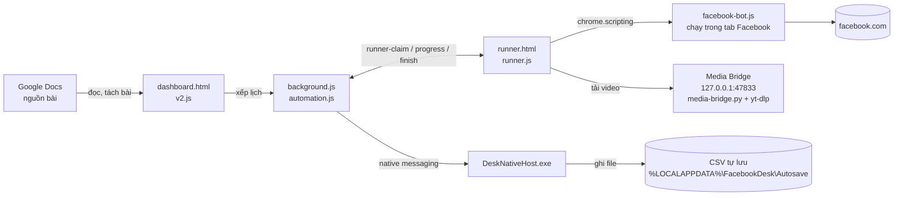
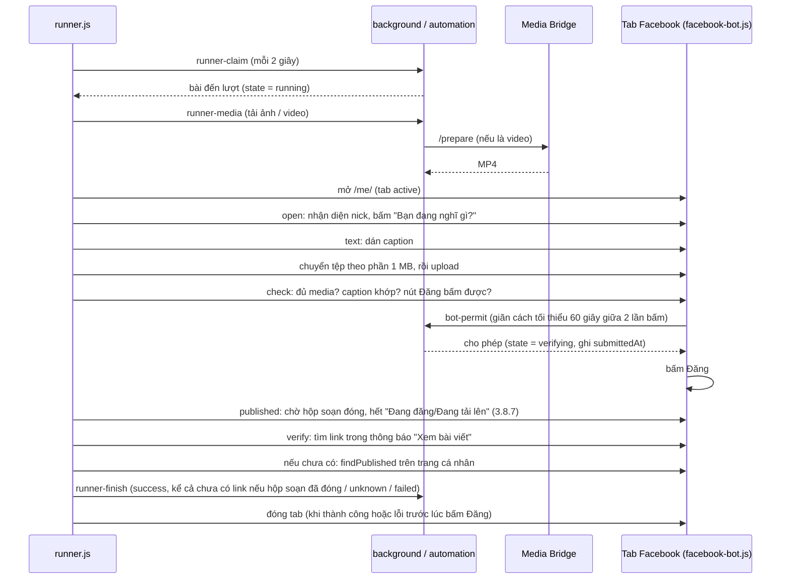
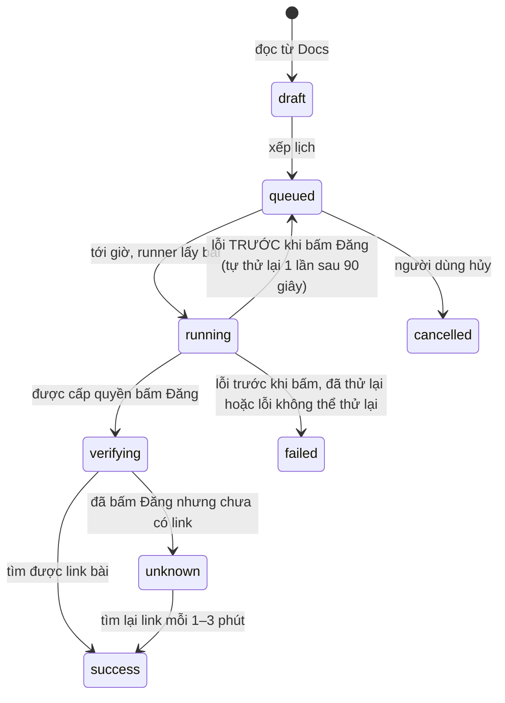

# FB Desk: cách hệ thống hoạt động

Tài liệu cho đồng nghiệp mới tiếp nhận. Cập nhật theo bản **3.8.7** (19/11/2026). Thay đổi của 3.8.7: [CHANGELOG-3.8.7.md](../CHANGELOG-3.8.7.md).

## 1. Hệ thống này làm gì

FB Desk là một extension Chrome dùng để **tự đăng bài lên trang cá nhân Facebook** theo lịch, cho nhiều nick cùng lúc.

- Mỗi nick chạy trong **một Chrome profile riêng**, có một bản extension riêng, hàng chờ riêng và file CSV tự lưu riêng.
- Nội dung bài (caption, ảnh, link video) lấy từ **Google Docs**. Mỗi tài liệu có nhiều "Bài N".
- Bot **không dùng API riêng của Facebook**. Nó thao tác trên giao diện web như người thật: mở ô soạn, dán chữ, tải ảnh, bấm Đăng.
- Video lấy từ link Facebook/Reel được **Media Bridge** (Python + yt-dlp, chạy trên máy) dựng thành MP4 trước khi tải lên.

## 2. Các thành phần



| Tệp | Vai trò |
|---|---|
| `background.js` | Service worker. Lưu dữ liệu (`chrome.storage.local`, khóa `deskV2`), nhận lệnh, tải media |
| `automation.js` | Hàng chờ bot: lấy bài đến lượt, cấp quyền bấm Đăng, ghi kết quả, tự thử lại, tìm lại link |
| `posting-plan.js` | Xếp lịch: mặc định cách nhau 3 phút |
| `runner.js` | Tab "Bot đang chạy": điều phối từng lượt đăng, mỗi lần một bài |
| `facebook-bot.js` | Chạy trong tab Facebook: nhận diện nick, mở ô soạn, điền chữ, tải ảnh, kiểm tra, bấm Đăng |
| `published-link.js` | Sau khi đăng: tìm link bài (permalink) trên trang cá nhân |
| `media-transfer.js` | Chuyển tệp lớn từ extension sang tab Facebook theo từng phần 1 MB |
| `media-bridge.py` | Server cục bộ dựng MP4 từ link video Facebook bằng yt-dlp + ffmpeg |
| `csv-autosave.js` | Tự xuất CSV tiến độ mỗi khi dữ liệu thay đổi |
| `restriction.js` | Phát hiện Facebook cảnh báo ("tạm thời bị chặn", "xác minh danh tính") và dừng bot |

## 3. Luồng đăng một bài



### Các nguyên tắc an toàn (không được bỏ)

1. **Không bao giờ đăng lại một bài đã bấm Đăng.** `submittedAt` được ghi *trước* khi bấm, nên dù tab hay Chrome sập giữa chừng, bài cũng chỉ sang `unknown` (cần đối soát), không quay lại hàng chờ.
2. **Không đăng riêng caption khi thiếu media.** Thiếu ảnh hoặc video thì dừng.
3. **Đúng nick mới đăng.** UID phiên đăng nhập (cookie `c_user`) phải trùng UID đã liên kết. Cookie chỉ được đọc tại máy, không gửi đi đâu.
4. **Facebook cảnh báo hạn chế thì dừng toàn bộ bot** của profile đó.

## 4. Trạng thái của một bài



| Trạng thái | Nhãn trên dashboard / CSV | Ý nghĩa |
|---|---|---|
| `queued` | Chờ tự đăng | Đang chờ tới giờ |
| `running` | Đang xử lý | Bot đang làm bài này |
| `verifying` | Đang tìm link | Đã bấm Đăng, đang tìm permalink |
| `success` | Đã đăng | Có link đã xác minh tác giả và nội dung, **hoặc** (3.8.7) Facebook đã đóng hộp soạn sau khi bấm Đăng mà không báo lỗi; link được tìm lại sau |
| `unknown` | Cần đối soát | **Đã bấm Đăng**, chưa lấy được link. Bài thường đã lên Facebook |
| `failed` | Chưa đăng / lỗi | Lỗi trước khi bấm Đăng, chưa có gì lên Facebook |

## 5. Lỗi thường gặp và tình trạng

Thống kê từ CSV tự lưu của 10 nick trong ngày 19/11.

| # | Lỗi (thông báo trong CSV) | Nguyên nhân | Tình trạng |
|---|---|---|---|
| 1 | "Có hộp thoại khác đang che bước đăng" | Bot coi mọi hộp thoại khác (chat Messenger…) là đang che nút Đăng | **Đã sửa (3.8.6)**: chỉ kiểm tra phần tử nằm đúng tại nút Đăng |
| 2 | "Chưa nhận diện được nick… không thấy nút sửa trang" | Dựa vào nút "Chỉnh sửa trang cá nhân", nút này bị ẩn khi ô soạn mở | **Đã sửa (3.8.6)**: so UID phiên đăng nhập |
| 3 | "Chưa xác minh đủ media tải xong" dù đủ ảnh | Đòi URL ảnh xem trước không đổi và mỗi ảnh có nút xóa riêng | **Đã sửa (3.8.6)**: đếm ảnh/video xem trước |
| 4 | Album "cần 6 ảnh, thấy 5 ảnh +2" | Ô cuối có nhãn "+N" đã nằm trong N, bot tính dư 1 | **Đã sửa (3.8.6.2)** |
| 5 | Bài đã lên nhưng mãi "cần đối soát" | Facebook để link dòng giờ đăng là `#` cho tới khi rê chuột (3.8.6.1). Còn một nguyên nhân chính: emoji hiển thị bằng `` nên chữ của bài không khớp caption ("khớp chữ=0") | **Đã sửa (3.8.7)**: so khớp bỏ emoji, ghi Đã đăng khi hộp soạn đóng |
| 11 | Album/video không lên | Bot chuyển tab đi tìm link 12 giây sau khi bấm Đăng, cắt ngang lúc album/video còn đang gửi | **Đã sửa (3.8.7)** |
| 12 | Caption "Facebook" / "của tác giả" | Post Research lấy chữ giao diện khi không đọc được caption (Reel) | **Đã sửa (3.8.7 + Post Research 0.2.22)** |
| 13 | Chọn 3 phút nhưng chạy 5–8 phút | Timer tab nền bị Chrome hãm; 3 phút tính tới lúc bắt đầu mở bài; tìm link chặn runner | **Đã sửa (3.8.7)** |
| 14 | Video AV1 | Facebook phát Reels bằng AV1/VP9 | **Đã sửa (3.8.7)**: Media Bridge chuyển sang H.264 |
| 6 | "Đã bấm mở bài nhưng chưa nhận diện được ô nhập" | Tab Facebook chạy nền nên Chrome không vẽ giao diện | **Đã sửa (3.8.6)**: tab chạy active, bỏ điều kiện opacity |
| 7 | "message channel closed…" | Service worker MV3 khởi động lại giữa lượt | **Đã sửa (3.8.6)**: runner tự thử lại |
| 8 | Dựng MP4: "không tìm được định dạng phù hợp" / "không lấy được video công khai" | Bộ lọc định dạng yt-dlp quá hẹp; video riêng tư hoặc đã xóa | **Sửa một phần (3.8.6)**: thêm định dạng dự phòng. Video riêng tư không xử lý được |
| 9 | "Extension chưa được ghép nối với Media Bridge" / "native messaging host is forbidden" | ID extension không có trong danh sách được phép | Thêm ID vào `media-bridge-config.json` và `media-native-host.json`, rồi khởi động lại Media Bridge |
| 10 | Dashboard chậm, máy lag | Runner hỏi việc 4 lần/giây, đọc lại toàn bộ dữ liệu (có ảnh base64) | **Đã sửa (3.8.6)**: hỏi mỗi 2 giây qua bản tóm tắt nhỏ |

### Việc còn mở

- 3.8.7 chưa chạy lượt đăng thật nào trên Facebook: cần nghiệm thu ghi nhận Đã đăng, album, video và nhịp 3 phút.
- Thỉnh thoảng một profile đứng ở trạng thái "Đang xử lý" quá 20 phút, thường do cửa sổ bị thu nhỏ hoặc đang chờ video.

## 6. Vận hành hằng ngày

### Cập nhật mã mà không mất dữ liệu

Extension được nạp dạng "unpacked". **ID extension phụ thuộc vào đường dẫn thư mục**, và dữ liệu (hàng chờ, tiến độ) gắn với ID đó.

1. Chép đè các tệp mới vào **đúng thư mục** Chrome đang nạp. Không nạp một thư mục khác, vì làm vậy sẽ ra ID mới với dữ liệu trống.
2. Ở từng profile: bấm **Dừng bot** và chờ hết "Đang xử lý". Sau đó mở `chrome://extensions`, bấm **↻ Tải lại** và kiểm tra phiên bản. Cuối cùng bấm **Tiếp tục**.
3. Tab "Bot đang chạy" giữ mã cũ trong bộ nhớ tới khi extension được Tải lại.

### Không làm

- Không thu nhỏ (minimize) cửa sổ Chrome đang chạy bot.
- Không gỡ (Remove) extension: mất toàn bộ hàng chờ.
- Không tự đăng tay một bài đang ở trạng thái "cần đối soát". Hãy kiểm tra trên Facebook trước, vì bài thường đã lên.

### Xem log

- CSV tự lưu: `%LOCALAPPDATA%\FacebookDesk\Autosave\`, mỗi profile một file, có kèm `.previous.csv` là bản trước đó.
- Cột `last_error` ghi lỗi gần nhất. Thông báo lỗi có dạng `Bước: lỗi [UI: trạng thái; ngôn ngữ; kích thước màn hình; tab visible/hidden]`.
- Media Bridge: `%LOCALAPPDATA%\FacebookDeskMedia\start-video.log`.

## 7. Kiểm thử

```
node tests/post-flow-386.mjs      # luồng đăng trên hộp soạn Facebook mô phỏng (11 kịch bản)
node tests/link-lookup-386.mjs    # tìm link bài trên timeline mô phỏng (5 kịch bản)
```

Hai bộ test này cần Chrome và Playwright, và không kết nối Facebook thật.
